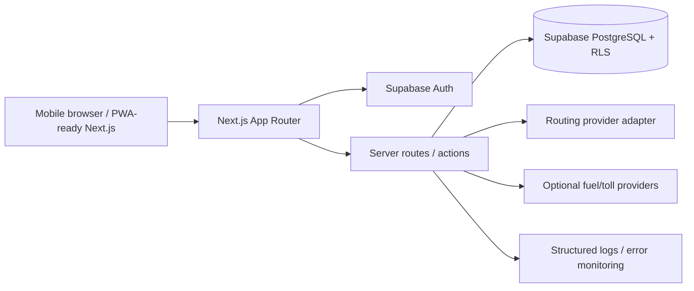

# 02 — Technical Requirements Document (TRD)

**Version:** 1.0 · **Status:** Proposed architecture; confirm provider quotas, pricing and terms

## 1. System overview



**Recommended thin MVP:** single Next.js TypeScript codebase, Supabase managed Auth/Postgres, Next.js server route handlers for protected external integrations and exports. Keep business rules in pure TypeScript modules for repeatable tests. Avoid introducing a second FastAPI service until there is a demonstrated need.

## 2. Tech stack

| Layer | Choice | Notes |
|---|---|---|
| App | Next.js App Router + TypeScript | Server-rendered public pages; authenticated app routes |
| UI | Tailwind CSS + accessible component primitives | Reusable responsive components |
| Validation | Zod | Shared schema for request and form validation |
| Database | PostgreSQL on Supabase | SQL migrations tracked in Git |
| Authentication | Supabase Auth | Secure server cookie integration; no auth tokens in localStorage |
| Maps | Selected routing provider behind interface | Evaluate Mappls/Mapbox/Google/OSM-based options for motorcycle coverage and license; do not assume any free allowance |
| Hosting | Vercel or compatible Next.js platform | Free plan eligibility and commercial use must be checked |
| Background tasks | None required for P0 | Later scheduled reminders via cron/edge functions |
| Telemetry | Privacy-conscious events + error logging | Never log tokens, precise route history or free-text notes |

## 3. Architectural boundaries

- **Browser:** forms, rendering, accessible feedback, optional optimistic UI; never trusts client-provided user_id.
- **Server/API:** authenticates session, validates input, applies rate limits, computes budgets, proxies routing queries, returns normalized provider data.
- **Database:** ownership constraints and RLS; source of truth for trips, estimates, expenses, bike and maintenance data.
- **External providers:** untrusted for persistence; normalize errors and keep short-lived cache subject to licensing.
- **AI:** out of scope for P0; any later AI only summarizes verified route options, not hazard/closure facts.

## 4. Key technical requirements

| ID | Requirement | Verification |
|---|---|---|
| TECH-01 | Every private table uses RLS tied to `auth.uid()` | User A cannot read/write User B entries using API or direct client SDK |
| TECH-02 | Use strict input validation on server | Bad numbers, identifiers and dates return 400/422; no write occurs |
| TECH-03 | Store monetary values as integer paise | Repeated sums exact; displayed INR formatted correctly |
| TECH-04 | Preserve estimate snapshot and provenance | Editing defaults later does not change old trip budget without explicit recalculation |
| TECH-05 | Support routing failure | Route error visible, manual distance entry available with `manual` source label |
| TECH-06 | No unauthorized open redirects or API-key exposure | Third-party secret keys never included in browser bundle |
| TECH-07 | Mutations are atomic and consistent | Expense linked only to a trip belonging to same owner; rollback on error |
| TECH-08 | Accessible loading/error/empty states | Keyboard/screen reader tests and slow-network usability |
| TECH-09 | Importable migrations and reproducible seed data | Clean staging DB initializes from migrations |
| TECH-10 | Privacy retention/deletion documented | Data export and deletion process tested |

## 5. Routing integration contract

Define `RoutingAdapter.getRoutes({ origin, destination, waypoints, vehicle: 'motorcycle' })` returning route candidates with `provider_route_id`, `distance_m`, `duration_s`, `encoded_geometry` or GeoJSON, `provider`, `generated_at`, optional provider warnings.

**Critical:** some providers expose *driving* routes without legally appropriate motorcycle handling. The app must label such routes as **general road routing**, not motorcycle-certified. Never infer road quality, scenicness, landslide risk, safe riding, operational petrol pumps or current closures without verified data. Always show instructions to independently review route and local conditions.

Provider selection checklist: India coverage, route-waypoint support, motorcycle profile and restrictions, toll coverage, API licensing, geocoding rules, map-tile storage restrictions, service quotas, SLA and estimated cost at 100/1,000/10,000 active users. Check OSM attribution when applicable. Cache only as permitted by contract.

## 6. Expense consistency and units

- Paise stored as signed BIGINT but validated `> 0` for normal expense entry.
- Trip/bike odometer uses integer km for MVP; allow decimal km only if product research requires it.
- Fuel volume uses `NUMERIC(10,3)` litres; efficiency `NUMERIC(7,2)` km/l.
- Store `timezone` as `Asia/Kolkata` for default rendering, use UTC `timestamptz` in DB.
- User-entered `price_per_litre_paise` is an optional snapshot; ensure fuel amount and litres need not match exactly because of rounding and receipt variation.
- Totals are calculated server-side or in SQL; no independent stored running-total column in P0.

## 7. Route and cost computation

For selected route `distance_m`, convert to km (decimal) for computation. Normalize options:

```ts
interface EstimateInput {
  distanceKm: number;              // > 0
  plannedMileageKmPerLitre: number; // > 0
  petrolPricePaisePerLitre: number; // >= 0
  tollPaise: number;               // >= 0
  foodPaise: number;
  stayPaise: number;
  otherPaise: number;
}
```

Compute fuel amount with decimal arithmetic, round to integer paise; produce a labeled snapshot including `fuel_litres`, `fuel_paise`, `total_paise`, `source_kind`, `source_label`, `source_timestamp`, `inputs` and `calculated_at`. Recalculate explicitly when route/inputs change; do not mutate old expense data.

## 8. APIs and request lifecycle

1. User signs in; browser gets secure session via Supabase Auth.
2. UI submits Zod-validated form data to authenticated server route.
3. Server obtains identity from verified auth session and never accepts a caller-supplied owner ID.
4. Server reads/updates user-owned rows; DB RLS enforces authorization independently.
5. API returns normalized JSON; UI updates after confirmed response and shows actionable errors.

Internal API examples (final payloads in `05-BACKEND-SCHEMA.md`):

| Method | Path | Purpose |
|---|---|---|
| GET/POST | `/api/bikes` | List/create bikes |
| PATCH | `/api/bikes/:id` | Update/archive bike |
| GET/POST | `/api/trips` | List/create trips |
| GET/PATCH | `/api/trips/:id` | Details/update/status |
| POST | `/api/routes/preview` | Geocode/routing via server adapter; rate limited |
| POST | `/api/trips/:id/estimate` | Write estimate revision |
| GET/POST | `/api/trips/:id/expenses` | Read/add expenses |
| PATCH/DELETE | `/api/expenses/:id` | Edit/remove expense |
| GET/POST | `/api/bikes/:id/maintenance` | List/add service records |
| GET | `/api/trips/:id/export.csv` | CSV download (P1) |

Use a consistent error envelope `{ error: { code, message, request_id } }`. Implement idempotency keys for expense creation to prevent duplicates after retries. Only enforce a `status` transition that the server explicitly allows.

## 9. Security and privacy

- Enable RLS on every tenant-scoped table and test policies with two actual accounts.
- Enforce ownership on child records by database constraints/triggers or secure RPC; never rely on UI filters alone.
- Server-only environment variables for external API secrets and Supabase service role; prefer user-session DB access, reserve service role for controlled administration.
- Validate coordinates (lat −90..90, lon −180..180), URLs, amounts, timestamp windows, payload sizes and text length; sanitize free text on display.
- Route preview endpoints need authenticated rate limits and per-account quotas to prevent API bill abuse.
- Protect session cookies, CSRF-sensitive mutations, redirect URLs and CORS. Set security headers and CSP compatible with map provider.
- If analytics used, record consent where required; do not send trip/route details or location to third-party analytics.
- Define backups, point-in-time recovery availability, restore rehearsal, retention policy and user-requested erasure before public launch.
- Payment webhook signing, subscription state and financial compliance are separately designed when PAY-01 is started.

## 10. Availability, performance and operations

**Initial SLO targets (hypotheses to verify):** authenticated core page usable within ~3 seconds on typical Indian 4G; ordinary DB writes p95 under 800 ms (excluding provider requests); routing preview should provide a timeout/retry path. These are pilot objectives, not guarantees. Use indexed ownership and trip foreign keys, paginate lists, lazy-load map assets, optimize JavaScript bundle and cap route-candidate count.

Monitoring: request success/error by endpoint, provider timeout/error/quota, expense duplicate prevention, database pool saturation, slow SQL, and approximate error budget. Exclude PII, coordinates and receipts from logs. Configure usage budgets/alerts; check hosting/provider pricing before promising ₹0–₹500/month.

## 11. Deployment environments and CI

- `local`, `staging`, `production` separated by Supabase projects and provider keys.
- GitHub Actions: typecheck, lint, unit, schema migration verification, RLS integration tests, browser smoke tests, dependency/security scans.
- Deploy migrations forward with backups and a documented rollback strategy; destructive changes require approval.
- Feature flags for price lookup, toll provider, exports, subscription and offline experiments.
- Production release from tagged commit with changelog and incident owner.

## 12. Tradeoffs / deferred decisions

Native applications, robust offline sync, offline maps, AI, mobile push, SMS verification, automated reminders and payment stack are deferred until pilot evidence supports them. Supabase and Vercel free plans may have usage and eligibility restrictions; pricing is subject to live vendor verification.

## Addendum A (2026-11-14): Checklist v2, shared links, offline map, waitlists

- **Checklist builder:** pure function `buildChecklist(profile)` in `src/features/trips/checklist.ts`; deterministic, unit-tested. Rules are alternatives (any matching condition applies). Insert uses `upsert ... ignoreDuplicates` on `(trip_id, label)`, so repeated presses never duplicate or overwrite statuses.
- **Real mileage:** `realMileage(fills)` uses consecutive fuel fills with odometer ("fill to full" method); returns null for implausible results (outside 5-120 km/l) instead of showing a misleading number.
- **Fuel plan:** `fuelPlan(...)` gives full-tank range, a 20% reserve range and distance markers. Markers are distances, not pump locations; this is stated in the UI.
- **Public share link:** `/s/[token]` reads through the service-role client and selects only title, route labels, status, latest estimate distance and expense total. Token is a random UUID stored on `trips.share_token`; null means private. Page is `noindex`, never cached, and returns 404 once sharing is turned off or the trip is archived.
- **Offline map:** MapLibre GL + PMTiles (OpenStreetMap data, ODbL attribution shown). The tile file is saved to IndexedDB and read through a `FileSource`. A service worker caches only `/map`, hashed `/_next/static/` files, label fonts and a fixed-path copy of the MapLibre worker (`public/map/vendor/`, copied by `scripts/copy-map-worker.mjs`). No user data, API responses or trips are cached.
- **Security:** CSP, anti-framing, nosniff, HSTS, Permissions-Policy set in `next.config.mjs`. Account deletion uses the service-role key server-side only.
- **Migrations:** tracked by `npm run migrate` in `public.schema_migrations`. Applied so far: 0001 init, 0002 integrity, 0003 value features, 0004 checklist v2 and waitlist.
- **Known limits:** in-memory rate limiter (single instance only); PMTiles public builds are for evaluation, so self-host the file for launch; offline *routing* and offline expense sync are not built.

## Addendum B (2026-11-14): V2.0 architecture

- **Modular monolith.** One Next.js app, one database, modules with clear boundaries: Auth/Profile, Touring, Garage, Community, Marketplace, Payments/Admin. Split out a service only when a measured need appears. No microservices.
- **Layers:** Next.js + TypeScript PWA (responsive, mobile-first, offline-capable forms later) -> server actions and route handlers -> Supabase (PostgreSQL, Auth, later media storage) -> external services (maps, routing, weather, payments) behind adapters.
- **Cross-module requirements:** a single user identity; explicit permissions for private trips, public profiles, club membership and listings; no public exposure of home address, raw location history or private documents; idempotent payment webhooks with server-side entitlements; source timestamp, coverage and confidence labels for any fuel, toll or road-condition data; retry-safe offline entry for expenses and checklist updates; admin tools for reports, takedown, restrictions and audit logs.
- **Document reminders (Garage):** `documentStatus(expiresOn, today)` in `src/features/garage/documents.ts`. Dates are calendar dates computed in India time (UTC+5:30), not instants. Expired starts the day after the expiry date.
- **Itinerary:** `src/features/trips/itinerary.ts` (pure, tested). Distances are entered by the rider, so totals are only as accurate as those entries; stops without a distance are counted and shown. Budget and itinerary are compared with a tolerance of max(10 km, 5%). A day over 400 km is flagged as a prompt, not a rule.
- **Navigation handoff:** a plain `https://www.google.com/maps/dir/?api=1&origin=...&destination=...&waypoints=...` link (max 9 waypoints, `rel=noopener noreferrer`, opens in a new tab). No API key, no server call, nothing is sent until the rider taps it. It uses the place names the rider typed and uses the general `driving` mode, so it is **not motorcycle-specific routing**.
- **Home dashboard:** `/home` aggregates service due state (`serviceDue`) and document state across the rider's non-archived bikes using RLS-scoped queries. No new service or cache is needed.
- **Waitlists and plan interest:** plain RLS tables, one row per user per topic/plan. `src/lib/waitlist.ts` is the only code that reads or writes the waitlist.
- **Reuse and abstraction:** routing is behind `RoutingAdapter` (OSRM-compatible implementation, off until `ROUTING_BASE_URL` is set). Payments will be behind an adapter too, but are not started.
- **Privacy law:** review India's Digital Personal Data Protection Rules against provisions in force at launch (consent, retention, deletion, grievance). See `08`.
- **Still open:** custom SMTP for auth emails, shared-store rate limiting, self-hosted map file, provider choice for routing, and the payment/entitlement design.

## Addendum C (2026-11-14): Rider profile architecture

- **Code:** `src/features/profile/` : `validation.ts` (pure input rules, handle normalisation, reserved words, cooldown helper), `public.ts` (the field whitelist that builds the public view), `service.ts` (server-only; the single place that decides who may see a profile and the only profile code that uses the admin client), `http.ts` (error mapping and rate limits). Screens: `/profile` (owner) and `/rider/[handle]` (public). APIs: `/api/profile`, `/api/profile/handle-available`, `/api/riders/[handle]/report`, `/api/riders/[handle]/block`.
- **Access model:** owner reads and writes through the session client (RLS applies). Everyone else reads only through the server: `resolveAccess` returns nothing for missing, private or blocked-viewer cases, and `toPublicProfile` builds the response field by field. There is no public JSON endpoint for profiles.
- **Concurrency:** handle uniqueness is a database unique constraint on a lowercase column. Racing claims resolve to exactly one winner; the loser gets `409 HANDLE_TAKEN`. Saves use explicit insert-or-update, never upsert (an upsert would run the insert path and reset the handle-change clock).
- **Rate limits (in memory, per account):** save 20/min, handle check 30/min, report 5/hour, block 30/min. Replace with a shared store before running more than one server.
- **CSRF:** the session cookie is SameSite=Lax, so cross-site form posts do not carry it.
- **Ride statistics:** SQL function `rider_stats(user)` returns counts only; executable by the service role only.
- **Error envelope** now may include a `field` name for validation errors.
- **Known limits:** profiles are not searchable and not indexed; no image upload; no moderator tooling yet.

## Addendum D (2026-11-14): Community Phase 1 architecture

- **Rules live in the database.** Migrations 0008 and 0009. Participation changes (join, invite, respond, decide, leave, remove) are SECURITY DEFINER functions that require sign-in, lock the ride row (so capacity checks cannot race), and raise short codes (`ride_full`, `not_found`, `ride_closed`, ...) that the application maps to plain messages. Browsers have **no insert, update or delete policy** on `ride_participants`.
- **Reads use row-level security:** `ride_visible(ride, user)` decides who can see a ride (host, participants who are not removed or left, or anyone for public open rides; never across a block). The host is checked directly on the row so `INSERT ... RETURNING` works.
- **Defence in depth:** database triggers stop a ride exceeding capacity, move the host off their own ride, reopen a cancelled ride, change the host, or shrink capacity below the confirmed riders.
- **Private details** live in a separate table (`ride_private`) readable only by the host and confirmed riders, so the exact meeting point cannot leak through a row-level read of the ride.
- **Discovery** is a server-only query over profiles that are Public and Discoverable, with a fixed field whitelist, 24 per page, search text sanitised, LIKE wildcards escaped, rate limited (30 per minute per account), signed-in only. The browser never receives user ids.
- **Handles, not ids,** are used in forms for host decisions; the server resolves the id and relies on row-level security to confirm the caller is the host.
- **Code:** `src/features/rides/` (validation, service), `src/features/profile/discovery.ts`, screens under `src/app/(app)/rides`, `riders`, `more`.
- **Rate limits (per account, in memory):** create ride 10/hour, join/leave/respond/invite 30/min, decisions 60/min, ride report 5/hour, rider search 30/min. Replace with a shared store before running more than one server.
- **Known limits:** no notifications (invitations and requests appear on Home and Rides only); no moderator tooling; ride and profile reports are stored but not yet actionable in the product.

## Addendum E (2026-11-14): Clubs architecture (migration 0010)

Same pattern as rides. Membership changes are SECURITY DEFINER functions (`club_request_join`, `club_invite`, `club_respond`, `club_decide`, `club_leave`, `club_remove`, `club_set_role`) that require sign-in, lock the club row and raise short codes; `club_members` has **no browser write policies**. Reads use `club_visible(club, user)` (owner directly, members and invitees, or public active clubs; never across a block). Triggers enforce: owner immutable, owner always active and role `owner`, capacity never exceeded, member limit never below active members, archived never reopened. Member names come from the server only (display name and handle, never ids); actions on a member use the handle and the server resolves the id, relying on row-level security to confirm the caller can see that member row. Code: `src/features/clubs/` and `src/app/(app)/clubs/`. Rate limits (per account): create club 5/hour, join/leave/respond/invite 30/min, decisions 60/min, report 5/hour. Known limits: no notifications; no moderator tooling.

## Addendum E (2026-11-14): Moderation architecture (migrations 0013, 0014)

Same pattern as rides, clubs and posts: no browser write access, SECURITY DEFINER functions, row-level security for reads.
- **Role:** `moderators(user_id)` has RLS enabled and no policy. Riders can call only `i_am_moderator()`, which answers for the caller. The helpers that take any user id (`is_moderator`, `is_restricted`, `mod_target_owner`) are not executable by riders.
- **Functions (EXECUTE: authenticated + service_role; each starts with a moderator check):** `mod_queue(scope, limit)`, `mod_act(kind, report, action, reason, days)`, `mod_lift_restriction(user, reason)`, `mod_restrictions()`. `mod_act` locks the report, changes the target, closes every open report on that target and writes the audit event in one transaction.
- **Restriction enforcement:** `restriction_guard()` BEFORE INSERT triggers on `posts`, `rides` and `clubs`.
- **Page and actions:** `/moderation`, `src/features/moderation/`. Every server action re-checks the moderator role, because an action can be called without the page. Non-moderators get `notFound()`.
- **Tests:** `npm run test:db:moderation`, `tests/unit/moderation.test.ts`.
