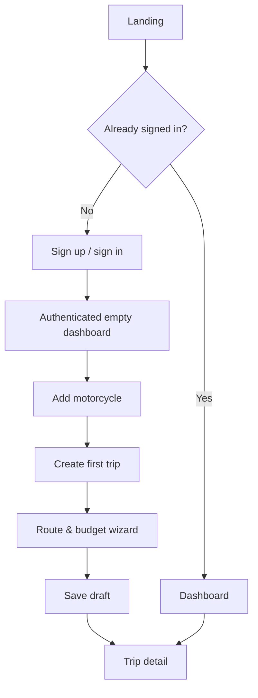
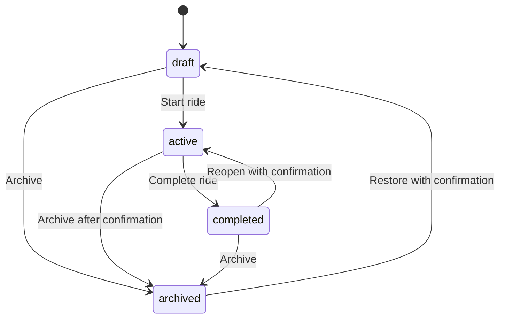
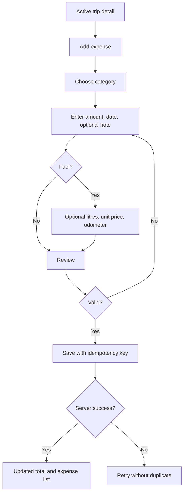
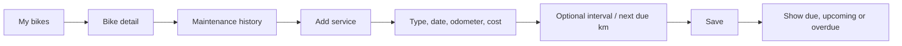

# 03 — Application Flow & User Journeys

**Version:** 1.0 · **Channel:** Mobile-first responsive web app

## 1. Sitemap

```text
/
├── Landing / How it works / Privacy / Terms
├── /login and /signup
└── /app (authenticated shell)
    ├── /dashboard                    upcoming/active trips, spending summary
    ├── /bikes                        list + add bike
    │   └── /bikes/:bikeId            bike detail, maintenance, edit
    ├── /trips                        draft/active/completed ride list
    │   ├── /trips/new                4-step plan wizard
    │   └── /trips/:tripId            budget, route, expense list and actions
    │       ├── /expenses/new         record spending
    │       └── /edit                 update draft and recalculate budget
    └── /settings                     profile, units, export, privacy
```

Only show links/actions permitted by current state. Save button states must reflect whether a write is pending/succeeded/failed.

## 2. First-time onboarding



**First-time dashboard:** one primary CTA: “Plan your first ride”. Bike creation is requested inside the wizard if none exists; riders are not forced to complete optional bike metadata.

## 3. Trip planning flow

| Step | Screen | User action | Validation / system behavior |
|---|---|---|---|
| 1 | Ride basics | Name (optional), origin, destination, trip date | Both places required; origin/destination distinct; past dates may be allowed for historical logging |
| 2 | Route review | Select provider route; optionally add waypoints | Show estimated km, route preview and provider details; if routing fails, allow manual km with warning |
| 3 | Bike and fuel | Select bike, mileage km/l, petrol price INR/litre | Values explicit, validated; show fuel litres and estimated cost immediately |
| 4 | Budget | Enter expected toll/food/stay/other | Save estimate snapshot with timestamp; display totals and disclaimer |
| Finish | Trip summary | Save draft or start ride | Persist trip + estimate transactionally; redirect to trip detail |

**Unsaved edits:** prompt before navigating away. **Route failure:** preserve entered form; never silently replace driving route with straight-line distance. **Budget inputs:** label fuel price entered by rider, and provider fuel price as indicative if eventually implemented.

## 4. Trip lifecycle



- **Draft:** plan and estimate editable; expenses may be added for prep costs only if explicitly enabled (P1); MVP restricts to active trips.
- **Active:** add/edit/delete expenses, inspect budget and enter actual distance.
- **Completed:** review and export; adding expenses requires reopening to avoid accidental edits.
- **Archived:** hidden from default lists, not deleted; restore allowed.

**State constraints:** One bike can have multiple planned trips. Trip states do not imply physical GPS tracking. No live “Ride now” screen required.

## 5. Logging an expense



Primary one-handed CTA placed at the bottom of trip detail. Expense timestamp defaults to user's current time; can backdate. Format ₹ and INR explicitly. On save failure, form remains populated; show recoverable explanation. Delete requires confirmation and offers a short undo experience if feasible.

## 6. Maintenance flow



- If the bike odometer is unknown, show `Odometer required for km-based reminders` rather than an invented due date.
- A new service entry does not automatically update global odometer unless the user explicitly confirms.
- Due status is informational, not a substitute for manufacturer's maintenance schedule or inspection.

## 7. Navigation, feedback and edge cases

| Case | UX expected |
|---|---|
| Signed-out user opens `/app/trips/:id` | Redirect to login; after login return to permitted destination |
| User opens another account's trip URL | Generic not found / forbidden; never reveal metadata |
| Provider unavailable or quota exhausted | Route error with retry and clearly marked manual distance alternative |
| Lost connectivity during expense save | Keep unsent form in memory; state “Not saved”; user can retry once online |
| Browser reload during lengthy wizard | Persist harmless draft locally without tokens, or preserve server draft; disclose local storage behavior |
| Invalid/expired session | Offer reauthentication; preserve non-sensitive unsent inputs where feasible |
| Zero planned km | Disallow cost-per-km; explain missing distance |
| Empty trip list | Practical empty state + “Plan a ride” button |
| High expense | Display budget overrun neutrally, not judgmentally |
| Completed trip edit attempt | Explain reopen requirement |
| Small mobile view / keyboard open | Sticky CTA remains reachable; inputs not obscured |

## 8. Screen inventory and transitions

| Screen | Primary action | Secondary action | Next |
|---|---|---|---|
| Landing | Plan your ride | Learn more | Login / app |
| Dashboard | New trip | Browse trips | Wizard / list |
| My bikes | Add bike | View history | Bike form / detail |
| Trip wizard | Continue | Back/save draft | Next wizard step |
| Trip detail | Add expense (active) | Edit/complete/export | Expense form / status dialog |
| Expense form | Save expense | Cancel | Trip detail |
| Bike maintenance | Add service | Edit bike | Service form |
| Settings | Export data | Delete account request | Confirmation process |

## 9. Analytics instrumentation (consent-aware)

Events: `signup_completed`, `bike_created`, `trip_draft_created`, `route_preview_success`, `route_preview_failed`, `trip_started`, `expense_created`, `trip_completed`, `maintenance_recorded`. Report event name, anonymous/internal cohort ID and generalized outcome only; **do not attach coordinates, full route or user-entered notes**.

## 10. Usability test scenarios

1. New user plans a 650-km ride and identifies what portion of its budget is based on their own inputs.
2. Returning user adds a fuel receipt in under 30 seconds while safely stopped.
3. Rider finds maintenance due threshold and corrects an incorrect odometer value.
4. Rider tries planning while routing provider is unavailable and succeeds with manually declared distance.
5. A user recognizes whether an expense has been saved after connection failure.

## Addendum A (2026-11-14): New and changed flows

**Sign-up:** `/signup` -> (if email confirmation is required) "check your email" notice on `/login` -> confirmation link `/auth/callback` -> `/bikes`. Expired or replaced link -> `/login?error=expired` with a resend form.

**Create trip:** adds optional *days*, *terrain*, *season* ("Not sure" allowed).

**Trip page sections (in order):** budget, real-mileage note, fuel stops, **itinerary**, actual vs estimate, expenses, ride readiness, share.

**Itinerary flow:** add a stop (day, place, type, km from previous stop, note) -> stops group under *Day N* with a km total -> if the itinerary total differs from the budget distance, an amber note says by how much and suggests saving a new budget revision -> days over 400 km show a rest/daylight prompt -> *Open route in Google Maps* opens the stops in order in a navigation app. Remove deletes one stop.

**Ride readiness flow:** set ride details -> "Add ride checklist" -> per item choose *Need it / Have it / Packed / N/A* -> progress shows ready/total -> if safety gear is still needed, a prompt links to `/marketplace`. Changing ride details and pressing "Update suggestions" appends new items only.

**Share flow:** "Create share link" -> `/s/<token>` visible to anyone with the link -> "Stop sharing" -> link returns 404.

**Pricing / marketplace pages:** public. Signed-out users are sent to `/signup`; signed-in users record interest (plan choice, or waitlist join/leave) with one click. No payment step exists.

**Map flow:** `/map` -> if no saved copy, loads from the server -> "Save map for offline use" (progress bar) -> map keeps working offline; "Remove saved map" frees storage. If the data file is not installed, the page explains how to install it.

## Addendum B (2026-11-14): V2.0 navigation and flows

**Signed-out landing:** hero "Every ride. Every bike. One home." with four doors: **Plan a Ride**, **My Garage** (live), **Find Riders**, **Gear Marketplace** (each labelled *Coming soon*, linking to a waitlist page). Signed-out visitors who pick a live door go to sign-up.

**Signed-in navigation:** Home, Trips, Garage, Map, Account, Sign out. After sign-in, sign-up confirmation or an email link, the rider lands on **Home**.

**Home ("Your riding space"):**
1. "Your next trip" card (most recent non-archived, non-completed trip) with *Open trip*, or "Plan a ride" when there is none.
2. **Needs attention:** overdue and due-soon services, expired and expiring documents, across all bikes, urgent first. Each row links to that bike. With bikes and no alerts it says "All clear"; with no bikes it prompts to add one.
3. Four tiles: Garage, Trips, Community (Soon), Gear market (Soon).

**Garage (bike page):** details (mileage, tank), **documents and expiry** (type, date, note; save again to renew; remove), service intervals and due state, service history.

**Waitlist pages (`/community`, `/marketplace`):** what is planned, a policy box, and one button. Signed-in riders join or leave with one click; signed-out visitors are sent to sign-up.

**Pricing (`/pricing`):** Free Rider plus Tour Pass, Rider Pro, Club Pro cards. Signed-in riders record which plan they would choose; no payment step exists.

Group ride, club and marketplace-listing flows are **not specified yet**; specify them before Phase 2.

## Addendum C (2026-11-14): Rider profile flows

**Entry points:** Home card and Account page -> `/profile`.

**Create / edit (`/profile`):** shows a preview of the **saved** version and its status chip (Public, or "Private: only you can see it"), then the form (handle, display name, avatar colour, bio, city, state, interests, visibility, show motorcycle + which one, show ride statistics). New profiles start Private. Saving shows "Profile saved." or a fixed message for the problem (handle taken, handle change limit with the date it reopens, invalid field). The handle field is read-only during the 30-day limit.

**Manage:** "Disable profile (make it private)" keeps everything but hides it; "Delete rider profile" removes it and frees the handle. A "Blocked riders" list has Unblock buttons.

**Public page (`/rider/<handle>`):** anyone with the link sees the chosen details. Owners see a banner ("Private preview" or "This is how other riders see your profile"). Signed-in visitors see **Block this rider** (or Unblock) and **Report this profile** (reason + optional details). Signed-out visitors see "Sign in to report or block". Missing, private, disabled and blocked-you profiles all show the same 404.

## Addendum D (2026-11-14): Community flows

**Navigation:** phone tabs are Home, Trips, **Rides**, Garage, **More**. More holds Find riders, Offline map, Rider profile, Account, Plans and the coming-soon pages. Wider screens show Home, Trips, Rides, Garage, Riders, Map, Account.

**Rides (`/rides`):** invitations (Accept or Decline), requests to review (Approve or Decline), rides you host, rides you are going on, requests you sent, and **Find rides** (city or area, when, only rides with space). "Host a ride" needs a rider profile.

**Host a ride (`/rides/new`) and edit (`/rides/[id]/edit`):** one form. The area field says it is shown to everyone; the meeting point field says it is shown only to confirmed riders. A notice states that riders will see the host's display name and handle.

**Ride page (`/rides/[id]`):** summary, host, headcount. Confirmed riders and the host also see the meeting point, the note and who is going. A non-member sees "The exact meeting point is shared with riders the host confirms". Actions depend on your status: Ask to join or Join, Withdraw request, Accept or Decline an invitation, Leave. The host sees Edit, Cancel, an invite-by-handle form, requests to approve, invitations to withdraw, and a Remove button on each rider. Anyone who is not the host can Report the ride. A short safety note sits at the bottom.

**Find riders (`/riders`):** search by name or handle, state, interest; paged. A hint explains how to be listed.

**Profile:** a "List me in Find riders" option under visibility.

**404 rule:** a missing ride, an invite-only ride you are not part of, a cancelled ride you were never in, and a ride by someone who blocked you all show the same 404.

## Addendum E (2026-11-14): Club flows

**Clubs (`/clubs`):** invitations (Accept or Decline), requests to review for clubs you manage, your clubs, requests you sent, and **Find clubs** (name, state). "Start a club" needs a rider profile. Reached from More, the Rides page and the wide-screen top bar.

**Club page (`/clubs/<link>`):** name, location, join style, member count, description. Your options follow your status: Join or Ask to join, Withdraw, Accept or Decline an invitation, Leave. Owners also see Edit and Archive; owners and admins see an invite-by-handle form, requests to approve and invitations to withdraw. Active members see the member list (name, handle, Owner or Admin badge); the owner can Make admin or Remove admin; owners and admins can Remove ordinary members. Anyone but the owner can report the club.

**404 rule:** a missing club, a private club you are not part of, and a club by someone who blocked you all show the same 404.
