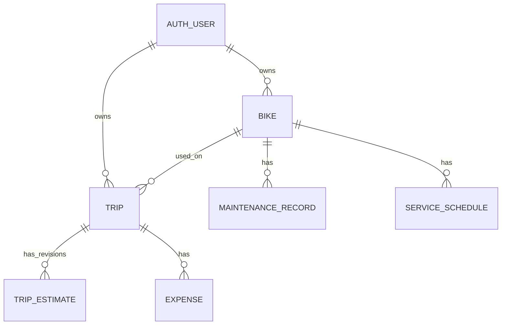

# 05 — Backend Schema, RLS & API Contracts

**Version:** 1.0 · **DB:** PostgreSQL / Supabase · **Status:** Implementation reference, not a reviewed production migration

## 1. Data architecture

The principal auth identity is `auth.users.id`. Every private domain row is directly owned by `user_id UUID`. Never accept `user_id` from client JSON. Child records must be constrained to the **same user** as their parent, even if IDs are guessed. Financial data is stored as **integer paise**; physical measurements use km, litres, km/l.



No public rider profiles, social graph, tracking trace, payment or booking tables in MVP.

## 2. SQL reference DDL

Run through **versioned migrations**. This is a baseline schema illustration that should be reviewed, tested and adjusted before applying to a production database. It assumes Supabase's `auth.users` already exists.

```sql
create extension if not exists pgcrypto;

create table public.bikes (
  id uuid primary key default gen_random_uuid(),
  user_id uuid not null references auth.users(id) on delete cascade,
  display_name text not null check (char_length(trim(display_name)) between 1 and 100),
  make text check (char_length(make) <= 100),
  model text check (char_length(model) <= 100),
  fuel_type text not null default 'petrol' check (fuel_type = 'petrol'),
  mileage_kmpl numeric(7,2) check (mileage_kmpl > 0 and mileage_kmpl <= 200),
  odometer_km integer check (odometer_km >= 0),
  odometer_updated_at timestamptz,
  is_archived boolean not null default false,
  created_at timestamptz not null default now(),
  updated_at timestamptz not null default now(),
  unique (id, user_id)
);

create table public.trips (
  id uuid primary key default gen_random_uuid(),
  user_id uuid not null references auth.users(id) on delete cascade,
  bike_id uuid not null,
  title text not null check (char_length(trim(title)) between 1 and 160),
  origin_label text not null check (char_length(trim(origin_label)) between 1 and 250),
  destination_label text not null check (char_length(trim(destination_label)) between 1 and 250),
  origin_lat numeric(9,6) check (origin_lat between -90 and 90),
  origin_lon numeric(9,6) check (origin_lon between -180 and 180),
  destination_lat numeric(9,6) check (destination_lat between -90 and 90),
  destination_lon numeric(9,6) check (destination_lon between -180 and 180),
  waypoints jsonb not null default '[]'::jsonb,
  travel_date date,
  status text not null default 'draft'
    check (status in ('draft','active','completed','archived')),
  route_distance_m integer check (route_distance_m > 0),
  route_duration_s integer check (route_duration_s >= 0),
  route_provider text,
  route_source_kind text check (route_source_kind in ('provider','manual')),
  route_external_id text,
  route_geometry jsonb,
  route_generated_at timestamptz,
  actual_distance_km numeric(10,2) check (actual_distance_km > 0),
  started_at timestamptz,
  completed_at timestamptz,
  created_at timestamptz not null default now(),
  updated_at timestamptz not null default now(),
  unique (id, user_id),
  foreign key (bike_id, user_id) references public.bikes(id, user_id)
);

create table public.trip_estimates (
  id uuid primary key default gen_random_uuid(),
  user_id uuid not null references auth.users(id) on delete cascade,
  trip_id uuid not null,
  revision integer not null check (revision > 0),
  distance_km numeric(10,2) not null check (distance_km > 0),
  mileage_kmpl numeric(7,2) not null check (mileage_kmpl > 0),
  fuel_price_paise_per_litre integer not null check (fuel_price_paise_per_litre >= 0),
  fuel_litres numeric(12,3) not null check (fuel_litres >= 0),
  fuel_paise bigint not null check (fuel_paise >= 0),
  toll_paise bigint not null default 0 check (toll_paise >= 0),
  food_paise bigint not null default 0 check (food_paise >= 0),
  stay_paise bigint not null default 0 check (stay_paise >= 0),
  other_paise bigint not null default 0 check (other_paise >= 0),
  total_paise bigint generated always as
    (fuel_paise + toll_paise + food_paise + stay_paise + other_paise) stored,
  input_sources jsonb not null default '{}'::jsonb,
  calculated_at timestamptz not null default now(),
  unique (trip_id, revision),
  foreign key (trip_id, user_id) references public.trips(id, user_id)
);

create table public.expenses (
  id uuid primary key default gen_random_uuid(),
  user_id uuid not null references auth.users(id) on delete cascade,
  trip_id uuid not null,
  category text not null check
    (category in ('fuel','toll','food','stay','maintenance','parking','other')),
  amount_paise bigint not null check (amount_paise > 0),
  spent_at timestamptz not null default now(),
  notes text check (char_length(notes) <= 1000),
  fuel_litres numeric(10,3) check (fuel_litres > 0),
  fuel_price_paise_per_litre integer check (fuel_price_paise_per_litre > 0),
  odometer_km integer check (odometer_km >= 0),
  client_request_id uuid not null,
  created_at timestamptz not null default now(),
  updated_at timestamptz not null default now(),
  unique (user_id, client_request_id),
  foreign key (trip_id, user_id) references public.trips(id, user_id),
  check (category = 'fuel' or
     (fuel_litres is null and fuel_price_paise_per_litre is null))
);

create table public.maintenance_records (
  id uuid primary key default gen_random_uuid(),
  user_id uuid not null references auth.users(id) on delete cascade,
  bike_id uuid not null,
  service_type text not null check
    (service_type in ('oil','chain','tyre','brake','general','other')),
  service_date date not null,
  odometer_km integer check (odometer_km >= 0),
  cost_paise bigint not null default 0 check (cost_paise >= 0),
  next_due_km integer check (next_due_km >= 0),
  notes text check (char_length(notes) <= 1000),
  created_at timestamptz not null default now(),
  updated_at timestamptz not null default now(),
  foreign key (bike_id, user_id) references public.bikes(id, user_id)
);

create table public.service_schedules (
  id uuid primary key default gen_random_uuid(),
  user_id uuid not null references auth.users(id) on delete cascade,
  bike_id uuid not null,
  service_type text not null check
    (service_type in ('oil','chain','tyre','brake','general','other')),
  interval_km integer not null check (interval_km between 1 and 100000),
  last_service_km integer check (last_service_km >= 0),
  enabled boolean not null default true,
  created_at timestamptz not null default now(),
  updated_at timestamptz not null default now(),
  unique (bike_id, service_type),
  foreign key (bike_id, user_id) references public.bikes(id, user_id)
);

create index idx_bikes_user on public.bikes (user_id, created_at desc);
create index idx_trips_user_status on public.trips (user_id, status, created_at desc);
create index idx_estimates_trip_revision on public.trip_estimates (trip_id, revision desc);
create index idx_expenses_trip_time on public.expenses (trip_id, spent_at desc);
create index idx_maintenance_bike_date on public.maintenance_records (bike_id, service_date desc);
create index idx_service_schedule_bike on public.service_schedules (bike_id);
```

**Review items before migration:** add triggers for `updated_at`; validate GeoJSON/waypoint shape at API boundary; decide max route geometry size; consider money overflow and date limits; verify appropriate delete cascades and whether preserving an archived bike is mandatory. Schema checks alone do not enforce allowed status changes.

## 3. Row-level security

Every six private tables must be RLS enabled, with grants and policies explicitly audited. Baseline policy pattern:

```sql
alter table public.bikes enable row level security;
alter table public.trips enable row level security;
alter table public.trip_estimates enable row level security;
alter table public.expenses enable row level security;
alter table public.maintenance_records enable row level security;
alter table public.service_schedules enable row level security;

create policy bikes_select on public.bikes
  for select to authenticated using (user_id = (select auth.uid()));
create policy bikes_insert on public.bikes
  for insert to authenticated with check (user_id = (select auth.uid()));
create policy bikes_update on public.bikes
  for update to authenticated
  using (user_id = (select auth.uid()))
  with check (user_id = (select auth.uid()));
create policy bikes_delete on public.bikes
  for delete to authenticated using (user_id = (select auth.uid()));
```

**Generate equivalent four-operation policies** for `trips`, `trip_estimates`, `expenses`, `maintenance_records`, `service_schedules` during implementation, then test via authenticated DB roles. Because clients can potentially bypass application endpoints when RLS grants allow direct mutations, enforce **state machine rules, estimate integrity and allowed writes at the DB layer** (e.g., restrictive grants + security-invoker RPC or trusted server-only writes; triggers for state validity). The composite foreign keys block cross-owner child linkage but do not themselves prevent client-side manipulation of an owner's generated estimates.

For release, prefer keeping browser direct CRUD limited to safe, RLS-backed operations. Make estimate creation / status transitions controlled API operations, with DB-enforced privilege boundaries. Service-role queries bypass RLS and must never be exposed to users.

## 4. Calculation integrity

- Keep trip estimate revisions immutable after insert. Allow new revisions only through a protected transaction that increments revision under lock.
- Avoid trusting `fuel_paise` supplied by the browser: derive using server-side decimal arithmetic from the validated inputs, and optionally protect with DB constraints/RPC.
- `actual_total_paise = SELECT COALESCE(SUM(amount_paise),0) FROM expenses WHERE trip_id=:id`, filtered through authenticated ownership.
- Current estimate is latest `revision`; completed trips retain their last selected budget snapshot unless deliberately re-opened/re-estimated.
- Duplicate expense POST with same authenticated `client_request_id` must return existing result rather than create another expense.
- Do not create maintenance costs as trip expenses automatically, otherwise double accounting is easy; if cross-linking is added later, use one canonical expense ID.

## 5. API payload examples

**POST `/api/bikes`**

```json
{ "display_name": "My touring bike", "mileage_kmpl": 29.5, "odometer_km": 16450 }
```

**POST `/api/trips`** (prefer initial draft, then route/budget update)

```json
{
  "bike_id": "<owned-bike-uuid>",
  "title": "Weekend ride",
  "origin_label": "Delhi",
  "destination_label": "Jaipur",
  "travel_date": "2026-12-05"
}
```

**POST `/api/routes/preview`**

```json
{
  "origin": { "lat": 28.6139, "lon": 77.2090 },
  "destination": { "lat": 26.9124, "lon": 75.7873 },
  "waypoints": []
}
```

Response (all values **illustrative**, not a verified actual route):

```json
{
  "routes": [{
    "route_id": "provider-route-ref",
    "distance_m": 270000,
    "duration_s": 18000,
    "route_source_kind": "provider",
    "provider": "selected-provider",
    "motorcycle_specific": false,
    "warnings": ["General driving route; verify motorcycle eligibility and local conditions"]
  }]
}
```

**POST `/api/trips/:id/estimate`**

```json
{
  "distance_km": 270,
  "mileage_kmpl": 30,
  "fuel_price_paise_per_litre": 10500,
  "toll_paise": 0,
  "food_paise": 50000,
  "stay_paise": 0,
  "other_paise": 10000,
  "input_sources": { "fuel": "user", "toll": "user" }
}
```

The backend returns calculated `fuel_litres: 9`, `fuel_paise: 94500`, `total_paise: 154500`, and `revision`, rather than accepting those fields from the client.

**POST `/api/trips/:id/expenses`**

```json
{
  "category": "fuel",
  "amount_paise": 112000,
  "spent_at": "2026-12-05T07:20:00+05:30",
  "fuel_litres": 10.5,
  "odometer_km": 16820,
  "client_request_id": "b757dd6a-e3b2-46bc-b0c3-e0dbde68d3d8"
}
```

**POST `/api/bikes/:id/maintenance`**

```json
{
  "service_type": "oil",
  "service_date": "2026-12-06",
  "odometer_km": 16900,
  "cost_paise": 180000,
  "next_due_km": 21900,
  "notes": "Regular change"
}
```

## 6. API error/status contract

| Scenario | Code | Body code |
|---|---|---|
| Validation failure | 422 | `VALIDATION_ERROR` |
| Missing/expired session | 401 | `AUTH_REQUIRED` |
| Record inaccessible | 404 | `NOT_FOUND` (avoid account existence leaks) |
| Invalid state transition | 409 | `INVALID_STATE` |
| Rate limit | 429 | `RATE_LIMITED` |
| Routing unavailable | 503 | `ROUTING_UNAVAILABLE` |
| Unexpected server failure | 500 | `INTERNAL_ERROR` |

Every response should include `request_id` in error metadata and matching server logs, with private details redacted.

## 7. Data lifecycle and policies

- A trip can be archived without deleting associated estimates/expenses. Hard deletion is a separate confirmed operation after retention policy approval.
- Bike archival must not break historical trips; reject hard deletion or require explicit cascade warning.
- Account erasure must remove auth identity and all dependent user data following documented workflow; backup retention requires policy disclosure.
- Routes/coordinates are potentially sensitive travel history: keep private, apply retention choices, never publish by default.
- Do not collect hotel receipts or payment identifiers in MVP.

## 8. Query patterns

```sql
-- Trip spending rollup; API must execute in authenticated context.
select trip_id, category, sum(amount_paise) as amount_paise
from public.expenses
where trip_id = $1
  and user_id = auth.uid()
group by trip_id, category;

-- Latest estimate, restricted by RLS.
select * from public.trip_estimates
where trip_id = $1 and user_id = auth.uid()
order by revision desc
limit 1;
```

## 9. Migration and test checklist

- [ ] Every private table has RLS enabled and SELECT/INSERT/UPDATE/DELETE behavior tested.
- [ ] Invalid cross-user bike-trip and trip-expense links rejected at database level.
- [ ] Immutable estimate revisions / controlled status transitions cannot be bypassed by direct SQL client grants.
- [ ] `updated_at` trigger applied to mutable tables only.
- [ ] Integer paise and decimal mileage calculations have golden unit tests.
- [ ] Concurrent duplicate expense creation resolves to one row.
- [ ] Real transaction rollback verified on composite write errors.
- [ ] Account export/erasure and archive semantics reviewed.
- [ ] Index and query plan checks on realistic sample volumes.

## Addendum A (2026-11-14): Schema changes in migrations 0003 and 0004

```sql
-- bikes
alter table bikes add column tank_litres numeric(5,2) check (tank_litres > 0 and tank_litres <= 100);

-- trips
alter table trips add column share_token uuid unique;           -- null = private
alter table trips add column trip_days integer check (trip_days between 1 and 60);
alter table trips add column terrain text check (terrain in ('plains','hills','mountains','desert'));
alter table trips add column season  text check (season  in ('summer','monsoon','winter'));

-- trip_checklist_items (RLS: owner only, 4 operations)
--   id, user_id, trip_id, category, label, status, sort_order, created_at
--   category in ('documents','safety','motorcycle','touring','essentials')
--   status   in ('needed','owned','packed','not_applicable')   default 'needed'
--   unique (trip_id, label); composite FK (trip_id, user_id) -> trips(id, user_id) on delete cascade

-- pro_interest (RLS: owner only)  user_id pk, plan in ('monthly','yearly'), created_at
-- waitlist     (RLS: owner only)  pk (user_id, topic), topic in ('marketplace'), created_at
-- schema_migrations               name pk, applied_at   (maintained by scripts/migrate.mjs)
```

**Planned for the marketplace (phase 2, not created):** `marketplace_listings`, `listing_images`, `listing_reports`, plus buyer-seller messaging and block tables. A `checklist_templates` table is **not** used: templates are code (`buildChecklist`) so they are versioned and tested with the app. Move them to a table only if non-developers need to edit them.

**Public read path:** the share page uses the service-role client and must select only the documented summary fields. It must never be extended to return notes, dates or individual expenses.

**Tests:** `npm run test:db` covers cross-account isolation for all tables including checklist, `pro_interest` and `waitlist`, and rejects invalid checklist statuses.

## Addendum B (2026-11-14): V2.0 data domains and migration 0005

| Domain | Entities | Status |
|---|---|---|
| Identity | `profiles`, `user_preferences` | Not created (auth users only) |
| Garage | `bikes`, `fuel_logs` (fuel expenses with odometer), `maintenance_records`, `service_schedules`, **`vehicle_documents`** | Created; fuel is stored as `expenses` of category fuel |
| Touring | `trips`, `trip_estimates`, `expenses`, `trip_checklist_items`, **`trip_stops`**; planned `trip_participants` | Created, except group tables. Trip length lives on `trips.trip_days`, so no `trip_days` table |
| Community | `clubs`, `club_members`, `rides`, `ride_rsvps`, `posts`, `post_reports` | Not created |
| Marketplace | `listings`, `listing_images`, `listing_inquiries`, `listing_reports` | Not created |
| Commercial | `plans`, `purchases`, `subscriptions`, `entitlements`, `payment_events` | Not created; only `pro_interest` exists |
| Operations | `notifications`, `moderation_cases`, `audit_events` | Not created |
| Interest | `pro_interest`, `waitlist` | Created |

```sql
-- vehicle_documents (RLS: owner only, 4 operations)
--   id, user_id, bike_id, doc_type, expires_on date, note (<=200), created_at, updated_at
--   doc_type in ('insurance','puc','registration','other'); unique (bike_id, doc_type)
--   composite FK (bike_id, user_id) -> bikes(id, user_id) on delete cascade
--   Stores NO document numbers and NO files, by design.

-- pro_interest.plan in ('tour_pass','pro_monthly','pro_yearly','club_pro')   -- replaces 'monthly'/'yearly'
-- waitlist.topic    in ('marketplace','community')
```

```sql
-- trip_stops (RLS: owner only, 4 operations; migration 0006)
--   id, user_id, trip_id, day_number (1..60), sort_order, place (1..200, not blank),
--   stop_type in ('ride','fuel','food','stay','sight','other'), leg_km numeric(7,1) (0..3000, entered by rider),
--   note (<=300), created_at; composite FK (trip_id, user_id) -> trips(id, user_id) on delete cascade
```

**Conventions kept:** UUID primary keys, foreign keys, indexes, strict ownership, RLS, money in integer paise. Marketplace and community tables must be designed with `08` (visibility, reports, blocks, audit) before creation. Never add a public read path that exposes private columns.

**Tests:** `npm run test:db` covers isolation and integrity for every table above that exists (26 checks), and fails if it crashes or runs no checks.

## Addendum C (2026-11-14): Profile tables (migration 0007)

```sql
-- rider_profiles (RLS: owner only; NO public select)
--   user_id pk -> auth.users, handle (unique, lowercase, ^[a-z0-9_]{3,20}$ with a letter, reserved list),
--   display_name (1..50), bio (<=300), location_city / location_state (<=60), interests text[] (fixed set, <=6),
--   avatar_color (fixed set), is_public default false, show_motorcycle, featured_bike_id, show_stats,
--   handle_changed_at (null until the first change), created_at, updated_at
--   composite FK (featured_bike_id, user_id) -> bikes(id, user_id)  -- cannot feature someone else's bike
--   check: show_motorcycle requires featured_bike_id
--   trigger enforce_handle_cooldown: one handle change per 30 days; ignores edits to handle_changed_at itself

-- profile_blocks (blocker_id, blocked_id) pk, no self-block; RLS: only the blocker can see/add/remove
-- profile_reports (id, reporter_id, profile_user_id, reason, note<=500, status) ; unique open report per
--   (reporter, profile); RLS: reporter can insert (status must be 'open') and see only their own
-- rider_stats(user uuid) -> (rides, km, places)   security definer, EXECUTE only for service_role
```

**Never stored here:** email, phone, address, registration number, VIN, documents, live location.

**Moderator access** to reports (status changes) will go through a separate admin role when the moderation tooling is built.

## Addendum D (2026-11-14): Community tables and functions (migrations 0008, 0009)

```sql
-- rider_profiles.discoverable boolean default false; constraint: discoverable requires is_public; a trigger clears it when the profile goes private
-- rides (RLS read: host directly, or ride_visible(); insert: host only AND must have a rider profile; update: host only; no delete)
--   id, host_id, title(3..100), description(<=1000), area_label(2..100, public), destination_label(<=100), starts_on, start_time, ends_on,
--   visibility in ('public','invite_only'), requires_approval, max_riders(2..100), distance_km(0..5000], status in ('open','cancelled')
-- ride_private (ride_id pk): meeting_point(<=200), host_note(<=500)   -- readable by host and confirmed riders only
-- ride_participants (ride_id, user_id) pk: status in ('invited','requested','going','declined','removed','left')
--   RLS read: yourself, the host, and confirmed riders (who see confirmed rows). NO write policies: changes only through functions
-- ride_reports: reason in ('spam','unsafe','inappropriate','harassment','other'), note(<=500), status; unique open report per reporter and ride;
--   insert allowed only for rides the reporter can see and does not host; reporter reads only their own

-- helpers (security definer): blocked_between(a,b), is_ride_host(ride,uid), ride_member_status(ride,uid), ride_visible(ride,uid), ride_going_count(ride)
-- participation functions (security definer, require sign-in, lock the ride row):
--   ride_request_join(ride) -> 'requested' | 'going'
--   ride_invite(ride, handle) -> 'invited' | 'going'          (public profiles only; never across a block)
--   ride_respond(ride, accept) -> 'going' | 'declined'
--   ride_decide(ride, user, approve) -> 'going' | 'declined'
--   ride_leave(ride) -> 'left'        ride_remove(ride, user) -> 'removed'
-- EXECUTE granted to authenticated and service_role only (not anon)
```

Triggers: host is added as a confirmed rider on insert; a ride cannot exceed `max_riders`; the host cannot be moved off; a cancelled ride cannot reopen; host cannot change; capacity cannot drop below the confirmed riders.

**Planned (not created):** clubs, club members, posts, ride photos.

**Tests:** `npm run test:db:community` (34 checks) covers visibility, the private meeting point, direct-write denial, approval, capacity, invitations, leave and removal, blocks, reports and function access, inside a rolled-back transaction.

## Addendum E (2026-11-14): Club tables and functions (migration 0010)

```sql
-- clubs (RLS read: owner directly or club_visible(); insert: owner only AND must have a rider profile; update: owner only; no delete)
--   id, owner_id, slug (unique, ^[a-z0-9_]{3,30}$ with a letter, reserved list), name(3..60), description(<=500), city(<=60), state(<=60),
--   visibility in ('public','private'), join_policy in ('open','approval','invite'), member_limit(2..1000), status in ('active','archived')
--   check: a private club must be invite only
-- club_members (club_id, user_id) pk: role in ('owner','admin','member'), status in ('invited','requested','active','declined','removed','left')
--   RLS read: yourself, the owner and admins, and active members (who see active rows). NO write policies
-- club_reports: reason in ('spam','unsafe','inappropriate','harassment','other'), note(<=500), status; unique open report per reporter and club
-- helpers: club_member_status, club_role (active members only), club_visible, club_member_count
-- functions: club_request_join, club_invite, club_respond, club_decide, club_leave, club_remove, club_set_role   (EXECUTE: authenticated + service_role only)
```

**Tests:** `npm run test:db:clubs` (30 checks) covers creation rules, visibility, direct-write denial, join policies, capacity, invitations, roles, owner protection, blocks, reports and function access, in a rolled-back transaction.

## Addendum: Moderation tables (migration 0013)

```sql
-- moderators(user_id pk)                      RLS on, NO policy: invisible to browsers
-- account_restrictions(user_id pk, reason, restricted_until null = until lifted, created_by)   rider may SELECT own row only
-- moderation_audit(id, actor_id, action, target_kind, target_id, report_id, reason, detail jsonb, created_at)
--     SELECT for moderators only; NO insert/update/delete policy; actor_id set null if the moderator account is deleted
-- post_reports, ride_reports, club_reports, profile_reports: + reviewed_by, reviewed_at
-- functions: i_am_moderator, mod_queue, mod_act, mod_lift_restriction, mod_restrictions (authenticated + service_role)
-- internal:  is_moderator, is_restricted, mod_target_owner, mod_require, restriction_guard (not executable by riders)
```

**Tests:** `npm run test:db:moderation` (19 checks).
